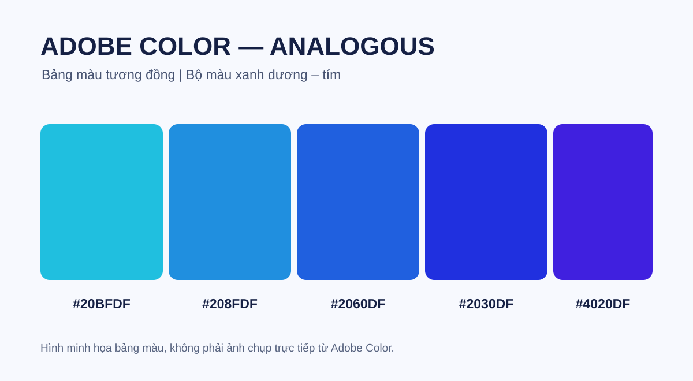

# Bài thực hành Adobe Color - Analogous

Bài thực hành lựa chọn một bảng màu theo quy tắc **Analogous (màu tương đồng)** tại [Adobe Color](https://color.adobe.com/create/color-wheel).

## Bộ màu đã chọn

| Màu | Mã HEX | Mô tả |
| --- | --- | --- |
| A | `#20BFDF` | Xanh ngọc |
| B | `#208FDF` | Xanh da trời |
| C | `#2060DF` | Xanh dương |
| D | `#2030DF` | Xanh lam đậm |
| E | `#4020DF` | Tím xanh |

## Cách thực hiện trên Adobe Color

1. Truy cập https://color.adobe.com/create/color-wheel.
2. Chọn quy tắc **Analogous**.
3. Chọn màu chủ đạo và điều chỉnh bộ màu theo các mã HEX trong bảng.
4. Lưu lại bảng màu (nếu có tài khoản Adobe).
5. Chụp ảnh màn hình giao diện Adobe Color có hiển thị bánh xe màu và các mã HEX.

## File bài nộp

- `Bang_mau_Analogous.svg`: ảnh minh họa bảng màu đã chọn, **không phải ảnh chụp trực tiếp từ Adobe Color**.
- `Ma_mau_Adobe_Color.txt`: các mã màu HEX.

> Để đáp ứng đúng yêu cầu nộp ảnh chụp màn hình từ Adobe Color, cần bổ sung ảnh thật sau khi thao tác trên website.
